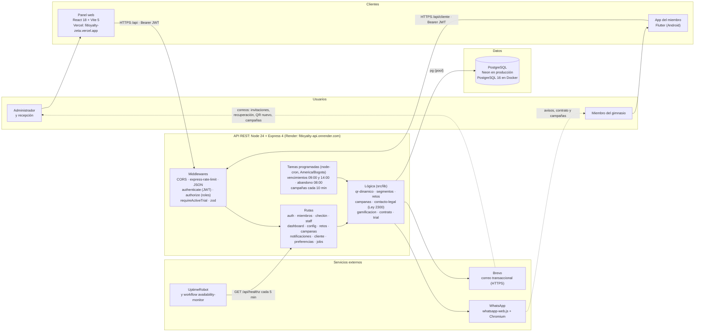
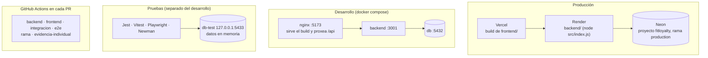
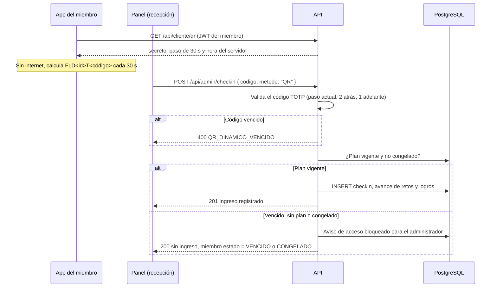
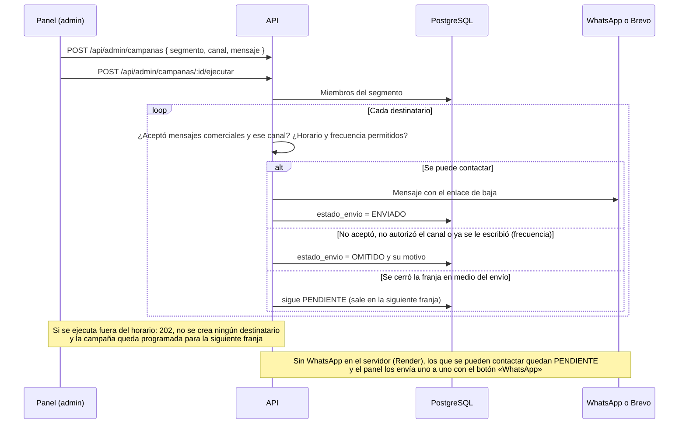

# Arquitectura de FitLoyalty y guion de la demo (T6, ítem 5)

| Dato | Valor |
|---|---|
| Ítem de la lista T6 | 5: «Diagrama de arquitectura actualizado; demo end-to-end del sistema completo» |
| Código revisado | `develop` @ `1f28949` (2026-11-25) |
| Documentos relacionados | [Documentación de la API](../api/API.md) · [Mapa de la base de datos](SCHEMA_MAP.md) · [ADR 0001: QR dinámico](../decisiones/0001-qr-dinamico-del-miembro.md) · [Pruebas](../pruebas/README.md) |

## 1. Diagrama de arquitectura



### Ambientes



## 2. Componentes

| Componente | Tecnología | Responsabilidad | Dónde está |
|---|---|---|---|
| Panel web | React 18, Vite 5, React Router 6, Axios | Lo usan el administrador y la recepción: miembros, check-in, equipo, retos, campañas, configuración y dashboard | `frontend/` |
| App del miembro | Flutter | Inicio de sesión con teléfono, QR dinámico, membresía, asistencia, logros, retos, mensajes, autorizaciones y contrato | `fitloyalty_cliente/` |
| API REST | Node 24, Express 4, `pg`, `zod`, `jsonwebtoken`, `bcryptjs` | Única puerta a los datos. Valida la entrada, autentica con JWT y aplica los roles y el periodo de prueba | `backend/src/` |
| Tareas programadas | `node-cron` | Avisos de vencimiento (09:00 y 14:00), alertas de abandono (08:00) y envío de campañas programadas (cada 10 min) | `backend/src/jobs/` |
| Base de datos | PostgreSQL (Neon en producción) | Gimnasios, usuarios, miembros, membresías, check-ins, retos, campañas y autorizaciones. Las migraciones se registran en `schema_migrations` | `backend/migrations/`, `ConsultasDB/` |
| Correo | Brevo (API HTTPS) | Invitaciones al equipo, recuperación de contraseña, QR del miembro nuevo y campañas por correo | `backend/src/lib/email.js` |
| WhatsApp | `whatsapp-web.js` con Chromium | Avisos de vencimiento, contrato y campañas por WhatsApp. Render no tiene Chrome: allí el panel abre el chat con el texto listo (`wa.me`) y deja la constancia | `backend/src/lib/whatsapp.js` |
| Monitoreo | UptimeRobot y `.github/workflows/availability-monitor.yml` | Revisa `GET /api/healthz` cada 5 minutos (RQNF-02). Esa ruta no toca la base | [Evidencia](../evidencias/rqnf-02-disponibilidad.md) |

### Capas del backend

```
Petición → CORS → express.json → rate limit (login, recuperación, cuenta, baja)
        → authenticate (JWT) → authorize(roles) → requireActiveTrial
        → ruta (routes/) → validación zod → lógica (lib/) → pool pg → PostgreSQL
        → errorHandler: { error, code } con 400 / 401 / 403 / 404 / 409 / 429 / 500
```

- **Multi-gimnasio:** las rutas del personal y de la app trabajan con el gimnasio o el miembro del JWT (`backend/tests/aislamiento.test.js` y `jobs-por-gimnasio.test.js`, RQNF-05). Solo las tareas programadas recorren todos los gimnasios. Un recurso de otro gimnasio responde 404, como si no existiera (por ejemplo, `backend/tests/acceso-bloqueado.test.js`).
- **Dos tipos de token:** el del personal (`role: admin` o `receptionist`) y el del miembro (`role: cliente`, con `idMiembro`). El del miembro entra a `/api/cliente/*` (y a `GET /api/billing/trial-status` y `POST /api/auth/logout`, que no tienen datos de otros); con el del personal, las de la app responden 403 `CLIENT_ONLY` (`requireClient`).
- **Errores:** casi todas las respuestas de error tienen la forma `{ error, code }` (`backend/src/middleware/errorHandler.js`). Las del contrato (`admin-contrato.js`) son `{ ok: false, error }`, sin `code`.

## 3. Flujos principales

### Check-in con QR dinámico (RQF-05, RQF-15)



### Campaña con las reglas de la Ley 2300 (RQF-10, RQNF-16)



## 4. Guion de la demo de principio a fin

**Duración:** unos 10 minutos. **Quién la hace:** una persona en el computador (panel) y otra con el celular (app).

**Antes de empezar:**
- **Necesita la release de `develop` a `main` y el despliegue en Render y Vercel.** La release 3 no tiene, entre otros, la contraseña de la app en el panel, los mensajes comerciales con la Ley 2300, `/api/cliente/preferencias` ni `/api/baja`. Antes de esa release, la demo se hace en local.
- Hacerla en un gimnasio de demostración, nunca con miembros reales. En local, `seed_dev.js` crea el gimnasio y su administrador (ver [Usuarios de prueba](../../README.md#usuarios-de-prueba)); los miembros se crean en el paso 3.
- Despertar el backend de Render 5 minutos antes: abrir `https://fitloyalty-api.onrender.com/api/health` y esperar `{"status":"ok"}`.
- Tener la app instalada en el celular y conectada a internet la primera vez, para que cargue el QR.
- El paso 12 solo envía dentro del horario que permite la Ley 2300: de lunes a viernes de 7:00 a. m. a 7:00 p. m. y los sábados de 8:00 a. m. a 3:00 p. m., nunca domingos ni festivos (`backend/src/lib/contacto-legal.js`). Fuera de ese horario la campaña queda programada para la siguiente franja, sin destinatarios todavía.
- Para el paso 12 en Render (sin Chrome), los que aceptaron WhatsApp quedan PENDIENTE y se envían con el botón «WhatsApp» de la lista, que abre el chat y los pasa a ENVIADO. Para mostrarlo por correo, el miembro debe tener correo y haber aceptado los dos canales: quien solo aceptó WhatsApp queda OMITIDO (`CANAL_NO_AUTORIZADO`).
- Crear antes al menos dos miembros: uno que acepte mensajes comerciales por los dos canales (con correo) y otro que no acepte, para que en el paso 12 se vean los dos resultados.
- Ponerle al miembro de la app un celular de 10 dígitos que empiece por 3 y que no tenga otro miembro, y una **«Contraseña de la app»** (en el alta o en su ficha). Sin contraseña, la app no deja entrar (403 `PASSWORD_NOT_SET`).
- El paso 14 necesita `QR_DINAMICO_SECRET` en el servidor. Sin él (tampoco está en `docker-compose.yml`), «Exigir QR dinámico» sale deshabilitado.
- **Plan B:** si falla internet o Render, correr todo en local con `docker compose up` ([Arranque rápido](../../README.md#arranque-rápido-con-docker-recomendado)). En local no salen correos (sin `BREVO_API_KEY`) ni WhatsApp automático, y la app instalada apunta a Render: hay que construirla con `API_URL` local o usar `adb reverse` por USB (ver `fitloyalty_cliente/README.md`).

| # | Paso (quién) | Qué se muestra | Resultado esperado | Requisito |
|---|---|---|---|---|
| 1 | Abrir el panel e iniciar sesión como administrador (panel) | Login con JWT | Entra al dashboard. Con una contraseña equivocada sale «Credenciales incorrectas»; después de 5 intentos en un minuto, «Demasiados intentos» (429) | Autenticación |
| 2 | Dashboard (panel) | Métricas, horas pico y exportar a CSV | Las cifras del gimnasio de demo; descarga del CSV | Dashboard |
| 3 | Miembros → Nuevo miembro (panel) | Formulario con plan, pago, «Contraseña de la app» y autorizaciones (términos, datos, mensajes comerciales y canales) | Se crea el miembro con su QR. Sin aceptar términos, el formulario no deja guardar | Miembros, Ley 1581 y Ley 2300 |
| 4 | Equipo → Invitar recepcionista (panel) | Invitación por correo con Brevo | La invitación queda pendiente y llega el correo | Equipo |
| 5 | Iniciar sesión en la app con el teléfono del miembro y la contraseña del paso 3 (celular) | Inicio, membresía y QR | Se ve el plan vigente y el QR, que cambia cada 30 s | App del miembro |
| 6 | Con la app abierta, poner el celular en modo avión y ver el QR (celular) | QR dinámico sin internet | El código sigue cambiando sin red (la app no guarda el QR: no hay que cerrarla antes) | QR dinámico (ADR 0001) |
| 7 | Check-in → escanear el QR (panel) | Registro del ingreso | «Ingreso registrado» y el ingreso en «Ingresos de hoy» | Check-in (módulo crítico) |
| 8 | Repetir el check-in con una foto del QR tomada hace más de 2 minutos (panel) | Seguridad del QR | Lo rechaza con «Este QR ya venció…» (400 `QR_DINAMICO_VENCIDO`). El código sirve entre 60 y 90 s: si aún vale, sale «ya registró su ingreso» | Check-in |
| 9 | Congelar la membresía del miembro e intentar otro check-in (panel) | Bloqueo de acceso | No registra el ingreso, muestra la membresía congelada y aparece el aviso de acceso bloqueado en notificaciones | Congelar y acceso bloqueado |
| 10 | Descongelar. En la app: asistencia y logros (celular) | Gamificación | Aparece el ingreso del paso 7, los puntos y los hitos con su porcentaje. La racha se ve en el check-in | Gamificación |
| 11 | Retos → Crear reto «3 asistencias» e inscribir (panel). En la app: Retos → ver el progreso (celular) | Retos | El reto aparece en la app con su progreso | Retos (RQF-12) |
| 12 | Campañas → Nueva campaña al segmento «Nuevos» por WhatsApp → Ejecutar (panel) | Campañas y Ley 2300 | Los que aceptaron WhatsApp quedan PENDIENTE y pasan a ENVIADO con el botón «WhatsApp» (con WhatsApp activo en el servidor, ENVIADO directo); los demás, OMITIDO con su motivo | Campañas (RQF-10) |
| 13 | Abrir el enlace de baja del mensaje y pulsar el botón (celular) | Darse de baja | El miembro deja de recibir mensajes comerciales; en la app se ve en «Más → Mensajes del gimnasio» | Ley 2300, art. 5 |
| 14 | Configuración → días de aviso, umbrales de abandono y «Exigir QR dinámico» (panel) | Configuración del gimnasio | Se guardan los cambios | Configuración |
| 15 | Cerrar con el CI de un PR y la página de UptimeRobot (navegador) | Calidad y disponibilidad | Los jobs en verde y la disponibilidad medida (confirmar el mismo día si hubo caídas en el horario operativo, 5:00 a 22:00) | Pruebas y RQNF-02 |

**Qué decir al cerrar (20 segundos):** el mismo backend atiende al panel y a la app, todo pasa por una sola API con JWT y roles, cada gimnasio solo ve sus datos, y el sistema se prueba en cada PR con el linter y pruebas unitarias, de integración, de componentes y end-to-end. La colección de Postman se corre a mano con Newman.

## 5. Cómo actualizar este documento

Los diagramas están en Mermaid, que GitHub muestra directamente. Si cambia un componente (una ruta nueva, otro servicio externo u otra tarea programada), se actualiza el diagrama de la sección 1, la tabla de la sección 2 y la [documentación de la API](../api/API.md) en el mismo PR.
